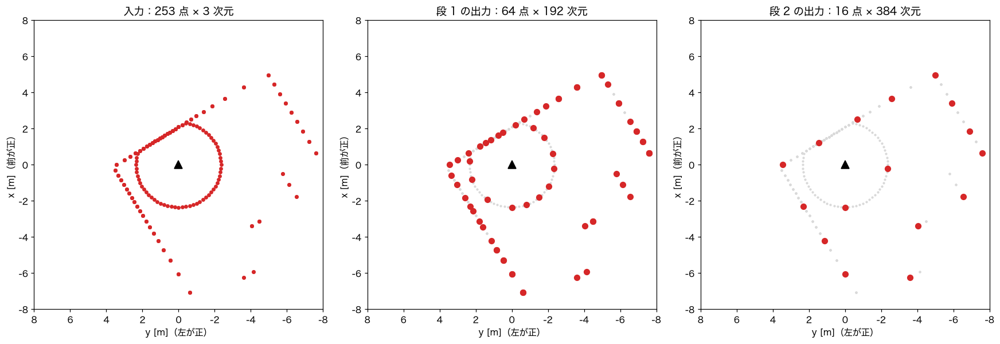
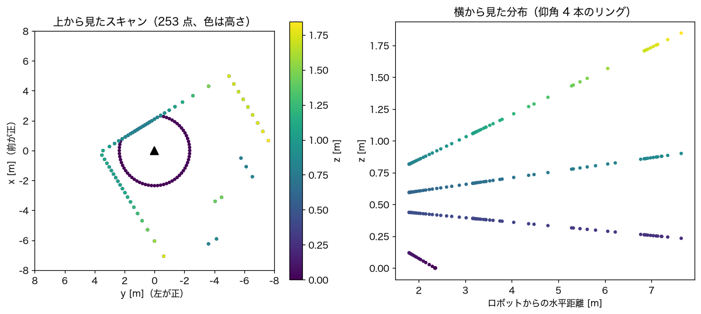
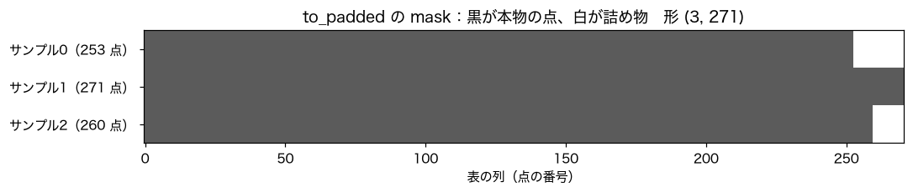
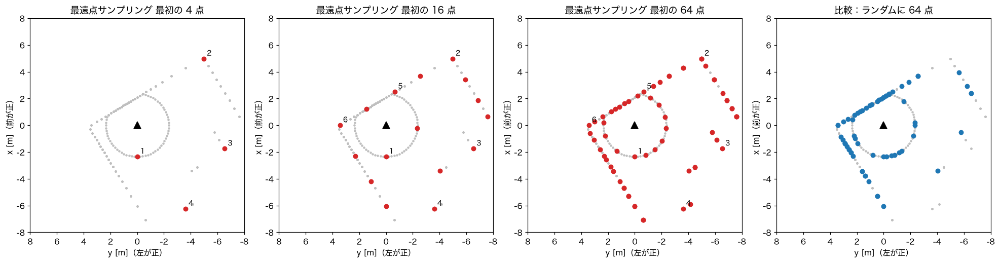
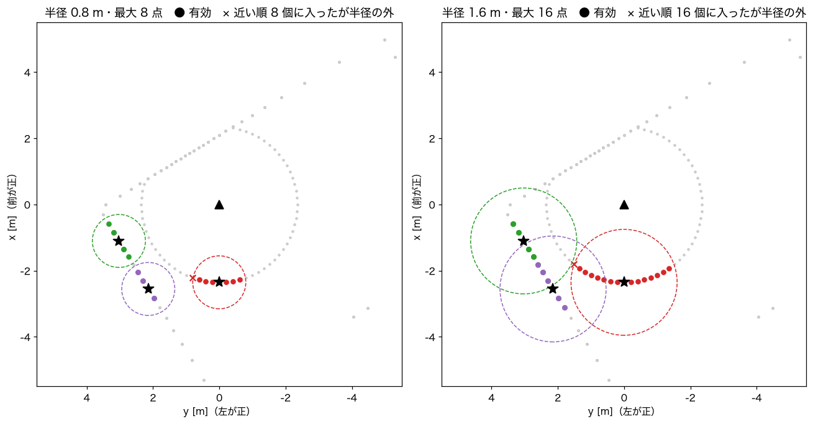
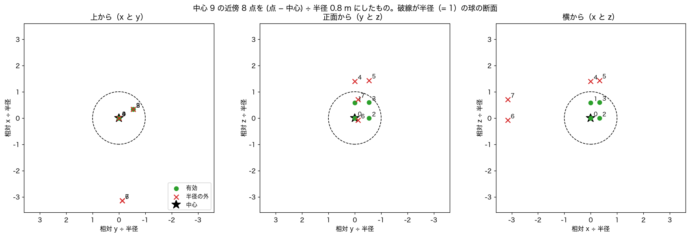
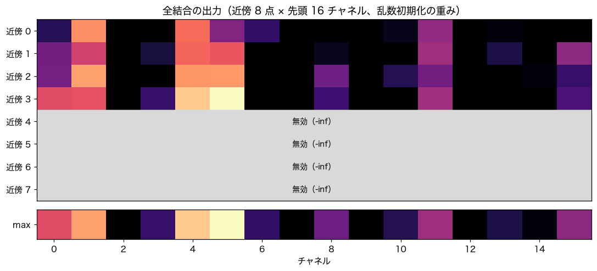

# PointNet++ エンコーダの中身

`physical_pointnet/encoders/pointnet2.py` が何をしているかを、順を追って説明します。使っている点群の演算（最遠点サンプリング、近傍探索など）は `physical_pointnet/points.py` にあります。

元の論文は Qi ほか「PointNet++: Deep Hierarchical Feature Learning on Point Sets in a Metric Space」（NeurIPS 2017、[arXiv:1706.02413](https://arxiv.org/abs/1706.02413)）です。

## 一言でいうと

点群を、**「近所ごとにまとめて要約する」を何回か繰り返し、最後に全体を 1 本のベクトルにする**仕組みです。

画像の畳み込みニューラルネットワーク（CNN）は、小さな窓で近くの画素をまとめ、段を重ねるごとに広い範囲を見ます。PointNet++ は同じことを点群でやります。ただし点群には画素のような格子がないので、「どこを窓の中心にするか」と「窓に入る点はどれか」を毎回計算で決めます。

## 前提：PointNet の考え方

PointNet++ の 1 つ 1 つの部品は、その前の PointNet（Qi ほか、CVPR 2017）です。PointNet は次の 2 段だけでできています。

1. 全部の点に、**同じ**全結合ネットワークを掛ける。点ごとに特徴ベクトルができる。
2. 全部の点の特徴を、チャネルごとに **max** でまとめる。

```text
点 1 (x, y, z) ──► 全結合 ──► [0.2, 1.5, 0.0, ...]
点 2 (x, y, z) ──► 全結合 ──► [0.9, 0.1, 0.3, ...]     チャネルごとに max
点 3 (x, y, z) ──► 全結合 ──► [0.4, 0.7, 2.1, ...]  ──►  [0.9, 1.5, 2.1, ...]
```

点群は「点の集合」で、並び順に意味がありません。同じ部屋のスキャンでも、点 1 と点 2 を入れ替えたら別の答えになる、というのでは困ります。どの点にも同じ全結合を掛け、順番に関係のない max でまとめれば、並び順を入れ替えても結果は同じです。

各チャネルは「こういう形の点があるか」を検出する役になります。max は「その形の点が 1 つでもあれば反応する」という意味です。

### PointNet の弱点

PointNet は、全部の点を最初から最後まで別々に処理し、最後に一度だけまとめます。点 1 の特徴を作るとき、隣にどんな点があるかを見ていません。「この点は壁の角の一部だ」「ここに細い柱がある」といった、近くの点どうしの関係から分かる形を捉えにくいです。

PointNet++ は、この PointNet を**近所ごとに**小さく掛けることで、この弱点を補います。

## 全体の流れ

既定の設定（このリポジトリのシミュレータ向け）で、1 スキャン 250 点前後の点群が 3 つ入ったバッチを例にします。テンソルの形は実際に通して確かめた値です。

```text
入力  3 サンプル × 250 点前後（coord はメートル、feat は割った xyz）
  │
  │ 表に詰め直す                                 xyz (3, 271, 3)、feat (3, 271, 3)
  ▼
段 1（セット抽象化）
  │ 1. 最遠点サンプリングで 64 点を中心に選ぶ
  │ 2. 各中心のまわりで近い点を集める（半径 0.8 m で最大 8 点、1.6 m で最大 16 点）
  │ 3. 中心からの相対位置と特徴を並べる
  │ 4. 小さな PointNet（全結合 → max）で 1 本にまとめる
  │                                              xyz (3, 64, 3)、feat (3, 64, 192)
  ▼
段 2（セット抽象化）
  │ 同じことを、64 点から 16 点、半径 2.0 m と 4.0 m で
  │                                              xyz (3, 16, 3)、feat (3, 16, 384)
  ▼
全体の段
  │ 残った 16 点に位置を付けて全結合 → 16 点の max
  ▼
出力  (3, 512)   ← サンプルごとに 512 次元のベクトル
```

実際のスキャン 1 枚で、各段に残る点を上から見ると次のようになります。灰色が入力の全点、赤がその段の出力の点です。



段 1 では 1 点が「半径 1 m くらいの近所の形」を表し、段 2 では「半径数 m の範囲の形」を表します。最後に部屋全体を 1 本にします。CNN で段を重ねるほど見える範囲が広がるのと同じです。点の数は 253 → 64 → 16 と減り、1 点あたりの特徴は 3 → 192 → 384 次元と増えます。

この 512 次元のベクトルが、状態の枝の出力と連結されて回帰ヘッドに入ります（[architecture.md](architecture.md)）。

## 入力：1 スキャンの点群

このドキュメントの図は、シミュレータの部屋の地図で取ったスキャンを使っています。図は `scripts/make_doc_figures.py` で、実際のエンコーダの関数に通して描いています。



左は上から見た図で、黒い三角がロボット（上が前）です。ロボットを囲む丸は、下向きのビームが床に当たった点（高さ 0）です。斜めの線は壁で、右の離れた点は棚や柱です。右は横から見た図で、仰角の違う 4 本のビームが、それぞれ 1 本の線になっています。点は約 0.2 m おきで、遠いほど間隔が空きます。

前処理（`preprocess_scan`）を通すと、1 点につき 2 種類の値ができます。

```text
coord（メートル、ロボット座標）      feat（エンコーダの入力。xy を 8、z を 2 で割った値）
[[-2.352, -0.000,  0.000],           [[-0.294, -0.000,  0.000],
 [-2.343, -0.205,  0.000],            [-0.293, -0.026,  0.000],
 [-2.317, -0.408,  0.000], ...]       [-0.290, -0.051,  0.000], ...]
```

`coord` は距離の計算（最遠点サンプリング、近傍探索）に、`feat` は全結合の入力に使います。

## 入力：点数がばらばらのバッチ

フレームごとに点数が違うので、エンコーダには全サンプルの点を縦につないだ `PointBatch` が来ます。

```text
coord  (784, 3)   ← 253 + 271 + 260 点を縦につないだもの
batch  (784,)     ← [0, 0, ..., 0, 1, 1, ..., 1, 2, ..., 2]  各点がどのサンプルか
```

最遠点サンプリングや近傍探索は「サンプルの中で」行う必要があります。PointNet++ ではまず、サンプルごとに 1 行の表へ詰め直します。足りない場所は 0 で埋め、本物の点かどうかを `mask` で持ちます。

```55:67:physical_pointnet/points.py
def to_padded(
    values: torch.Tensor, batch: torch.Tensor, batch_size: int, fill: float = 0.0
) -> tuple[torch.Tensor, torch.Tensor]:
    """(M, C) を (B, Nmax, C) に詰め直す。mask は実在する点で True。"""
    counts = torch.bincount(batch, minlength=batch_size)
    start = torch.cumsum(counts, 0) - counts
    local = torch.arange(batch.numel(), device=batch.device) - start[batch]
    nmax = int(counts.max())
    out = values.new_full((batch_size, nmax, values.shape[-1]), fill)
    out[batch, local] = values
    mask = torch.zeros(batch_size, nmax, dtype=torch.bool, device=batch.device)
    mask[batch, local] = True
    return out, mask
```

3 枚のスキャン（253、271、260 点）を詰め直したときの `mask` は次のとおりです。一番多い 271 点に合わせて表の幅が決まり、足りないサンプルの右端が詰め物（白）になります。



```text
xyz   (3, 271, 3)    ← サンプル × 表の列 × xyz
feat  (3, 271, 3)
mask  (3, 271)       ← サンプル0 は先頭 253 列が True、サンプル2 は先頭 260 列が True
```

以降の計算は、詰め物（`mask` が False の場所）を中心にも近傍にも選ばないようにしています。そのため、詰め物の数が違っても結果は変わりません。同じサンプルを単独で入れたときとバッチの中で入れたときで、出力が完全に一致することを確かめています。

## セット抽象化の 1 段

ここが PointNet++ の中心です。コード全体は次のとおりです。

```47:64:physical_pointnet/encoders/pointnet2.py
    def forward(
        self, xyz: torch.Tensor, feat: torch.Tensor, mask: torch.Tensor, random_start: bool
    ) -> tuple[torch.Tensor, torch.Tensor, torch.Tensor]:
        batch, count, _ = xyz.shape
        npoint = min(self.npoint, count)
        new_xyz = gather_points(xyz, farthest_point_sample(xyz, mask, npoint, random_start))
        counts = mask.sum(dim=1, keepdim=True)
        new_mask = torch.arange(npoint, device=xyz.device).unsqueeze(0) < counts
        outs = []
        for radius, k, mlp in zip(self.radii, self.nsamples, self.branches):
            idx, valid = ball_query(new_xyz, new_mask, xyz, mask, radius, k)
            rel = (gather_points(xyz, idx) - new_xyz.unsqueeze(2)) / radius
            grouped = torch.cat([rel, gather_points(feat, idx)], dim=-1)
            hidden = grouped.new_full((batch, npoint, k, mlp.out_channels), float("-inf"))
            hidden[valid] = mlp(grouped[valid]).to(hidden.dtype)
            pooled = hidden.max(dim=2).values
            outs.append(torch.where(new_mask.unsqueeze(-1), pooled, torch.zeros_like(pooled)))
        return new_xyz, torch.cat(outs, dim=-1), new_mask
```

4 つのステップに分けて見ていきます。

### ステップ 1：中心を選ぶ（最遠点サンプリング）

まず、近所の中心にする点を `npoint` 個選びます（段 1 なら 64 個）。

ランダムに選ぶと、点の密集した場所（ロボットの近くの床や壁）ばかりが選ばれ、遠くの疎な場所に中心が来ません。最遠点サンプリング（farthest point sampling、FPS）は、**すでに選んだ点から一番遠い点を、次の中心にする**ことを繰り返します。

```text
1 回目  適当な 1 点 A を選ぶ
2 回目  A から一番遠い点 B を選ぶ
3 回目  「A と B のうち近いほうまでの距離」が一番大きい点 C を選ぶ
4 回目  「A、B、C のうち一番近いものまでの距離」が一番大きい点を選ぶ
...
```

こうすると、中心は点群の広がり全体にまんべんなく散らばります。実際のスキャンで、最初の 4 点、16 点、64 点を選んだところと、ランダムに 64 点選んだところを並べます。数字は選ばれた順番です。



1 番目は配列の先頭にあったロボット真後ろの床の点、2 番目はそこから一番遠い右前の壁、3 番目と 4 番目は右側の離れた点です。64 点になると、壁、棚、床の丸に均等に並びます。ランダムだと、点の多いロボット近くの壁と床に偏り、右側の棚や遠くの壁の点がほとんど選ばれません。

```77:98:physical_pointnet/points.py
def farthest_point_sample(
    xyz: torch.Tensor, mask: torch.Tensor, npoint: int, random_start: bool = False
) -> torch.Tensor:
    """詰めた点群 (B, N, 3) から npoint 点を最遠点サンプリングで選ぶ。

    実在する点が npoint より少ないサンプルでは、先頭の実在点数ぶんだけが別々の点で、
    残りは重複する。呼び出し側で先頭だけを有効として扱う。
    """
    batch, count, _ = xyz.shape
    rows = torch.arange(batch, device=xyz.device)
    distance = torch.where(mask, torch.full_like(mask, float("inf"), dtype=xyz.dtype), -1.0)
    if random_start:
        farthest = torch.multinomial(mask.to(xyz.dtype), 1).squeeze(1)
    else:
        farthest = torch.zeros(batch, dtype=torch.long, device=xyz.device)
    chosen = torch.empty(batch, npoint, dtype=torch.long, device=xyz.device)
    for i in range(npoint):
        chosen[:, i] = farthest
        d = ((xyz - xyz[rows, farthest].unsqueeze(1)) ** 2).sum(-1)
        distance = torch.where(mask, torch.minimum(distance, d), -1.0)
        farthest = distance.argmax(dim=1)
    return chosen
```

`distance` は「各点から、選んだ中心のうち一番近いものまでの距離」です。中心を 1 つ選ぶたびに、その中心までの距離と比べて小さいほうに更新し、`distance` が一番大きい点を次の中心にします。

- 詰め物の点は `distance` を -1 にしているので、選ばれることはありません。
- 学習中（`random_start=True`）は最初の点をランダムに選びます。同じスキャンでも毎回少し違う中心になり、増強のような効果があります。推論では先頭の点から始めるので、同じ入力なら毎回同じ答えになります。
- 本物の点が `npoint` より少ないサンプル（たとえば 40 点しかないのに 64 個選ぶ）では、40 個を選んだあとは同じ点が繰り返し選ばれます。呼び出し側の `new_mask` で、先頭 40 個だけを有効な中心として扱います。

ループは `npoint` 回まわります。1 回ごとに全点との距離を計算するので、点が数万あり `npoint` が数千になると、ここが重くなります（後述）。

### ステップ 2：近所の点を集める（ball query）

次に、各中心のまわりで、半径 `radius` 以内の点を最大 `nsample` 個集めます。

```101:129:physical_pointnet/points.py
def ball_query(
    centers: torch.Tensor,
    center_mask: torch.Tensor,
    xyz: torch.Tensor,
    mask: torch.Tensor,
    radius: float,
    k: int,
    chunk_elems: int = 1 << 25,
) -> tuple[torch.Tensor, torch.Tensor]:
    """各中心から近い順に最大 k 点を取り、半径の外と存在しない点を無効にする。

    距離表は中心をいくつかずつに区切って作るので、メモリは chunk_elems 要素程度に収まる。
    返り値は近傍の番号 (B, S, k) と有効フラグ (B, S, k)。
    """
    batch, nsrc, _ = centers.shape
    count = xyz.shape[1]
    k_eff = min(k, count)
    idx = torch.zeros(batch, nsrc, k, dtype=torch.long, device=xyz.device)
    valid = torch.zeros(batch, nsrc, k, dtype=torch.bool, device=xyz.device)
    step = max(1, chunk_elems // max(1, batch * count))
    invalid = ~mask.unsqueeze(1)
    for s0 in range(0, nsrc, step):
        s1 = min(nsrc, s0 + step)
        d = torch.cdist(centers[:, s0:s1], xyz).masked_fill(invalid, float("inf"))
        dist, nn_idx = d.topk(k_eff, dim=-1, largest=False)
        idx[:, s0:s1, :k_eff] = nn_idx
        valid[:, s0:s1, :k_eff] = dist <= radius
    valid &= center_mask.unsqueeze(-1)
    return idx, valid
```

やっていることは次のとおりです。

1. 中心と全点の距離を計算する（`torch.cdist`）。詰め物の点は距離を無限大にして、選ばれないようにする。
2. 近い順に `k` 個を取る（`topk`）。
3. そのうち半径の内側にあるものだけを「有効」とする。

返り値は、近傍の点の番号 `idx` と、それが有効かどうかの `valid` です。形はどちらも `(サンプル数, 中心の数, k)` です。

実際のスキャンで、3 つの中心（★）のまわりを集めたところです。破線の円が半径、● が有効な近傍、× は「近い順の `k` 個には入ったが半径の外」の点です。



左（半径 0.8 m）では、近所の壁や床の数点だけが集まります。右（半径 1.6 m）では、同じ中心でもっと長い範囲の壁が入ります。距離は 3 次元で測っているので、上から見て円の中にあっても、高さが離れている点は入りません。

1 つの中心について、`ball_query` が返す値を実際に出すと次のようになります（段 1、中心 9 番、半径 0.8 m、`k` = 8）。中心は右後ろにある障害物の上の点（x = -3.40 m、y = -4.05 m、z = 0.32 m）です。

```text
idx    [ 76,  138,  77,  139,  198,  199,  75,  137]   ← 近い順の点番号
dist   [0.00, 0.46, 0.50, 0.69, 1.12, 1.25, 2.52, 2.58]  ← 中心からの距離 [m]
valid  [  1,    1,   1,    1,    0,    0,   0,    0]    ← 半径 0.8 m 以内なら 1
```

近い 4 点が有効で、残り 4 点は半径の外です。8 個の枠は埋まっていますが、使われるのは 4 個だけです。

- 中心は点群の中の点そのものなので、距離 0 の自分自身が必ず 1 つ入ります（上の `idx` の先頭の 76 番）。有効な近傍が 0 個になることはありません。
- 点が多いと距離の表 `(サンプル数, 中心の数, 全点数)` が大きくなります。そこで中心をいくつかずつに区切って計算し、メモリを一定以下に抑えています（`chunk_elems`）。

実際のシミュレータのスキャン 3 枚で、半径内に入った点の数を数えると次のようになりました。

| 段 | 半径 | 最大の点数 `k` | 平均 | 最小 | `k` 個ちょうど埋まった割合 |
| --- | --- | --- | --- | --- | --- |
| 1 | 0.8 m | 8 | 5.6 | 1 | 40% |
| 1 | 1.6 m | 16 | 12.9 | 1 | 49% |
| 2 | 2.0 m | 8 | 6.5 | 1 | 58% |
| 2 | 4.0 m | 16 | 14.7 | 7 | 77% |

半径を決めるときは、このように「半径内に平均でいくつ入るか」を数えて、`k` と同じくらいかやや少ない程度になるようにします。ほとんど 1 点（自分だけ）なら半径が小さすぎ、いつも `k` 個で頭打ちなら、半径の外側の点を見ていないことになります。

### ステップ 3：中心からの相対位置を並べる

集めた点それぞれについて、「中心からどれだけずれているか」と、その点が持っている特徴を横に並べます。

```python
rel = (gather_points(xyz, idx) - new_xyz.unsqueeze(2)) / radius
grouped = torch.cat([rel, gather_points(feat, idx)], dim=-1)
```

- **相対位置にする理由**：近所の「形」を見たいからです。同じ L 字型の壁の角が、ロボットの右前にあっても左後ろにあっても、中心から見たずれ方は同じです。絶対位置のままだと、場所ごとに別の形として覚え直す必要があります。
- **半径で割る理由**：段 1 の相対位置は ±0.8 m 程度、段 2 は ±4 m 程度と、段によって大きさが違います。半径で割るとどの段でも -1〜1 くらいに揃い、全結合が扱いやすい大きさになります。
- **特徴**：段 1 では、前処理で作った特徴（倍率を掛けた xyz、強度などがあればそれも）です。段 2 では、段 1 が出した 192 次元の特徴です。

段 1 の場合、1 つの近傍の点は「相対位置 3 + 特徴 3 = 6 次元」のベクトルになります。

上の中心 9 番の近傍 8 点を、相対位置 ÷ 半径にしたものです。番号は上の `idx` の並び（0 が中心自身）です。



```text
       相対 x  相対 y  相対 z    （すべて ÷ 0.8 m）
0      0.00    0.00    0.00     ← 中心自身
1      0.00    0.00    0.58     ← 真上の点（1 本上のビーム）
2      0.33   -0.54   -0.01     ← 右斜め前の同じ高さ
3      0.33   -0.54    0.59
4      0.00    0.00    1.40     ← 半径の外（上すぎる）
5      0.33   -0.54    1.44     ← 半径の外
6     -3.15   -0.12   -0.08     ← 半径の外（後ろすぎる）
7     -3.15   -0.12    0.70     ← 半径の外
```

上から見ると、0、1、4 番は同じ場所に重なっています。高さだけが違う点で、障害物の縦の面に、仰角の違うビームが上下に並んで当たったものです。正面と横から見ると、半径（= 1）の球の中に入っているのが 0〜3 番だけだと分かります。全結合はこの数字を受け取り、「真上と右斜め前に点がある（縦の面がある）」という形を特徴に変えます。

### ステップ 4：小さな PointNet でまとめる

近所ごとに、PointNet と同じことをします。集めた点それぞれに同じ全結合を掛け、近所の中で max を取ります。

```python
hidden = grouped.new_full((batch, npoint, k, mlp.out_channels), float("-inf"))
hidden[valid] = mlp(grouped[valid]).to(hidden.dtype)
pooled = hidden.max(dim=2).values
```

全結合は `_SharedMLP` で、「Linear → BatchNorm → ReLU」を重ねたものです。

```21:33:physical_pointnet/encoders/pointnet2.py
class _SharedMLP(nn.Module):
    """行ごとに同じ全結合を掛ける。入力は (R, C)。"""

    def __init__(self, channels: list[int]):
        super().__init__()
        layers: list[nn.Module] = []
        for cin, cout in zip(channels, channels[1:]):
            layers += [nn.Linear(cin, cout, bias=False), nn.BatchNorm1d(cout), nn.ReLU(inplace=True)]
        self.net = nn.Sequential(*layers)
        self.out_channels = channels[-1]

    def forward(self, x: torch.Tensor) -> torch.Tensor:
        return self.net(x)
```

ここには 2 つの工夫があります。

**有効な点だけを全結合に通す。** `grouped[valid]` は、有効な近傍の点だけを 1 列に並べたものです。半径の外の点や詰め物は全結合に入りません。BatchNorm は入ってきた値の平均と分散で正規化するので、無効な点を混ぜるとその統計がずれます。有効な点だけを通せば、統計も本物の点だけから計算されます。

**無効な場所は負の無限大にしてから max を取る。** 全結合の出力を、最初に負の無限大で埋めた箱に書き戻します。無効な場所は負の無限大のまま残るので、max では絶対に選ばれません。自分自身が必ず有効なので、max の結果が負の無限大になることもありません。

中心 9 番の近傍 8 点を段 1 の全結合（半径 0.8 m 側）に通したときの出力を、先頭 16 チャネルだけ表示します。重みは学習前の乱数なので値そのものに意味はありませんが、計算の流れは学習後と同じです。



上の 8 行が近傍 8 点、1 列が 1 チャネルです。明るいほど値が大きく、黒は 0（ReLU で 0 になったもの）です。半径の外の 4 点（近傍 4〜7）は全結合に通さず、負の無限大のまま残ります。下の 1 行が列ごとの max で、これがこの中心の 64 次元の特徴（の先頭 16 個）になります。チャネル 5 のように 1 点だけが強く反応した値も、max ならそのまま残ります。

中心自体が無効（本物の点が `npoint` より少ないサンプルの、余った中心）の場合は、結果を 0 にして次の段へ渡し、次の段でも中心や近傍に選ばれないようにしています。

段 1 の全結合は、半径 0.8 m 側が 6 → 32 → 32 → 64、1.6 m 側が 6 → 64 → 64 → 128 です。1 つの中心につき 64 次元と 128 次元のベクトルができます。

### 2 つの半径を並べる（MSG）

1 つの中心について、半径を 2 通り（段 1 なら 0.8 m と 1.6 m）にしてステップ 2〜4 を別々に行い、結果を横に並べます。

```python
return new_xyz, torch.cat(outs, dim=-1), new_mask
```

段 1 の出力は 64 + 128 = 192 次元です。これを multi-scale grouping（MSG）と呼びます。

点群は場所によって密度が大きく違います。ロボットの近くは点が密で、小さい半径でも十分な数の点が入ります。遠くは疎で、小さい半径だと自分 1 点しか入りません。2 つの半径を並べておけば、密な場所では細かい形を、疎な場所では広い範囲の形を、それぞれ使えます。どちらを重く見るかは学習で決まります。

### 1 段の入出力のまとめ

| | 入力 | 出力 |
| --- | --- | --- |
| 段 1 | 約 250 点。各点に 3 次元の特徴 | 64 点。各点に 192 次元の特徴 |
| 段 2 | 64 点。各点に 192 次元の特徴 | 16 点。各点に 384 次元の特徴 |

点の数は減り、1 点が表す範囲と特徴の次元は増えます。出力の点の位置は、選ばれた中心の位置（メートル）です。

## 最後の段：全体を 1 本にする

最後に、残った 16 点をまとめて 1 本のベクトルにします。

```91:99:physical_pointnet/encoders/pointnet2.py
    def forward(self, points: PointBatch) -> torch.Tensor:
        xyz, mask = to_padded(points.coord, points.batch, points.batch_size)
        feat, _ = to_padded(points.feat, points.batch, points.batch_size)
        for layer in self.layers:
            xyz, feat, mask = layer(xyz, feat, mask, random_start=self.training)
        grouped = torch.cat([xyz * self.coord_scale, feat], dim=-1)
        hidden = grouped.new_full((*mask.shape, self.out_channels), float("-inf"))
        hidden[mask] = self.global_mlp(grouped[mask]).to(hidden.dtype)
        return hidden.max(dim=1).values
```

ここはステップ 3〜4 とほぼ同じですが、相対位置ではなく、**ロボットから見た絶対位置**（`coord_scale` を掛けて 1 前後にしたもの）を付けます。全結合は 384 + 3 → 256 → 512 で、16 点の max を取ると 512 次元になります。

絶対位置を付けるのは、このタスクでは「どこに何があるか」が答えを決めるからです。同じ壁の角でも、真正面 1 m にあれば止まるべきで、真後ろにあれば気にせず進めます。近所の形は相対位置で、その形がロボットから見てどこにあるかは最後の段の絶対位置で表します。

`coord_scale` の既定値は 1/8 で、シミュレータの最大距離 8 m に合わせています。屋外で 50 m 先まで使うなら 0.02 程度にします。

## 設定の決め方

設定はすべて `PointNet2Encoder` の引数です。JSON で渡すと既定値を上書きできます（`--encoder-config`）。

```json
{
  "sa_layers": [
    {"npoint": 64, "radii": [0.8, 1.6], "nsamples": [8, 16], "mlps": [[32, 32, 64], [64, 64, 128]]},
    {"npoint": 16, "radii": [2.0, 4.0], "nsamples": [8, 16], "mlps": [[64, 64, 128], [128, 128, 256]]}
  ],
  "global_mlp": [256, 512],
  "coord_scale": 0.125
}
```

| 項目 | 意味 | 決め方の目安 |
| --- | --- | --- |
| `sa_layers` の数 | 段の数 | 点が数百なら 2 段、数万なら 3〜4 段 |
| `npoint` | その段で残す中心の数 | 前の段の 1/4 前後。入力点数より小さく |
| `radii` | 近所の半径（メートル） | 見たい物の大きさ。段が進むごとに 2 倍前後に広げる |
| `nsamples` | 近所から集める最大の点数 | 半径内に実際に入る数と同じくらい（上の表のように数えて決める） |
| `mlps` | 近所ごとの全結合の幅 | 段が進むごとに広げる。最後の数の合計が次の段の特徴の次元 |
| `global_mlp` | 最後の段の全結合の幅 | 最後の数がエンコーダの出力の次元 |
| `coord_scale` | 最後の段の絶対位置に掛ける倍率 | 1 / 使う最大距離 |

屋外向けの例 [`configs/encoders/pointnet2_outdoor.json`](../configs/encoders/pointnet2_outdoor.json) は、前処理後に数万点あることを想定しています。3 段（4096、1024、256 点）で、半径は 0.5〜4 m、出力は 1024 次元です。

半径と `npoint` は組で考えます。中心どうしの間隔は、おおよそ「点群の広がり ÷ 中心の数の 1/2 乗〜1/3 乗」になります。半径がこの間隔より小さいと、どの中心の近所にも入らない点が出て、その点の情報は次の段に伝わりません。間隔と同じくらいか、それより大きい半径を少なくとも 1 つ入れておきます。

## 速さとメモリ

重いのは次の 2 か所です。

- **最遠点サンプリング**：`npoint` 回のループで、毎回全点との距離を計算します。計算量は「点数 × `npoint`」です。屋外の例の段 1（6 万点から 4096 点）が一番重くなります。
- **近傍探索**：「中心の数 × 全点数」の距離の表を作ります。区切って計算するのでメモリは抑えていますが、計算量は変わりません。

CPU（4 スレッド）で、屋外の例の設定に 6 万点 × 2 フレームを通すと約 4 秒でした。GPU ではずっと速くなります。それでも足りないときは、`points.py` の `farthest_point_sample` と `ball_query` を、[torch_cluster](https://github.com/rusty1s/pytorch_cluster) などの CUDA 実装に差し替えられます。関数の入出力を同じにしておけば、エンコーダ側は変えずに済みます。

前処理のボクセル間引き（`voxel_size`）で点数を先に減らしておくと、両方とも軽くなります。

## 公開実装との違い

組み立ては、分類用の公開モデル `pointnet2_cls_msg`（[charlesq34/pointnet2](https://github.com/charlesq34/pointnet2)、PyTorch 移植の [yanx27/Pointnet_Pointnet2_pytorch](https://github.com/yanx27/Pointnet_Pointnet2_pytorch)）と同じです。違うのは次の点です。

| | 公開実装 | このリポジトリ | 理由 |
| --- | --- | --- | --- |
| 点数 | バッチ内で同じ数に揃える | サンプルごとに違ってよい | 屋外の LiDAR は毎回点数が違う |
| 座標の単位 | 物体を半径 1 の球に縮める | メートルのまま | 壁までの距離そのものが大事。半径もメートルで決められる |
| 相対位置 | そのまま | 半径で割る | どの段でも値の大きさを揃える |
| 近傍の取り方 | 半径内の点を番号順に最大 k 個。足りなければ最初の点を繰り返す | 近い順に最大 k 個。足りない分は max から外す | 半径内に k 個より多いとき近い点を優先する。複製は不要 |
| 全結合 | `Conv2d`（1×1） | `Linear` と `BatchNorm1d` | 同じ計算。有効な点だけを通せる |
| 最後の段 | 絶対位置（物体の中心が原点） | ロボットから見た絶対位置 × `coord_scale` | どこに何があるかを残す |
| 出力 | クラスの対数確率 | 512 次元のベクトル | 回帰ヘッドは別のモジュール |

## よくある疑問

**点の並び順を入れ替えると、結果は変わる？**
全結合と max だけなら変わりません。ただし推論では、最遠点サンプリングを「先頭の点」から始めます。並び順を変えると最初の点が変わり、選ばれる中心が少しずれるので、出力もわずかに変わります（試したときの差は 0.02 程度）。学習中は最初の点をランダムにしているので、どの点から始めても同じように答えられるように学習されます。

**ロボットが向きを変えたら？**
点群はロボット座標なので、ロボットが回れば点群も回ります。PointNet++ は回転しても同じ答えを出す仕組みではありません。このタスクでは、向きによって出すべき指令（どちらに曲がるか）が変わるので、それで正しいです。左右反転の増強（`mirror_prob`）は、左右を入れ替えた状況も学習させるためのもので、そのとき角速度と目標の左右位置の符号も反転します。

**点が 1 つしかないサンプルは？**
動きます。中心も近傍も自分 1 点だけになり、その特徴がそのまま出ます。前処理で全部の点が落ちたときは、原点に点を 1 つ置いて渡します。

**なぜ max で、平均や合計ではない？**
合計は点の数が多いほど大きくなり、密な場所と疎な場所で値の大きさが変わってしまいます。平均は「1 本だけある細い柱」のような少数の点を薄めます。max は「その形の点が 1 つでもあるか」を拾えるので、障害物の検出に向いています。

## 確認したこと

学習はしていません。合成データとシミュレータのスキャンで次を確かめています。

- 最遠点サンプリングが同じ点を 2 回選ばず、詰め物を選ばない。
- 近傍探索が、全点との距離を全部調べた結果と同じ数の点を返し、半径の外と詰め物を有効にしない（区切って計算しても同じ）。
- 点数の違うサンプル（30、300、1200 点、1 点だけのサンプルも含む）で順伝播と逆伝播が通り、全パラメータに有限の勾配が付く。
- 同じサンプルを単独で入れたときとバッチの中で入れたときで、出力が完全に一致する。
