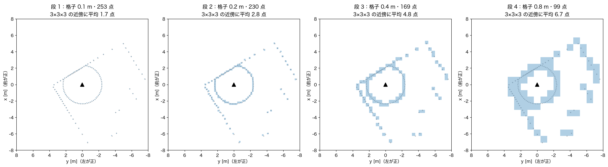
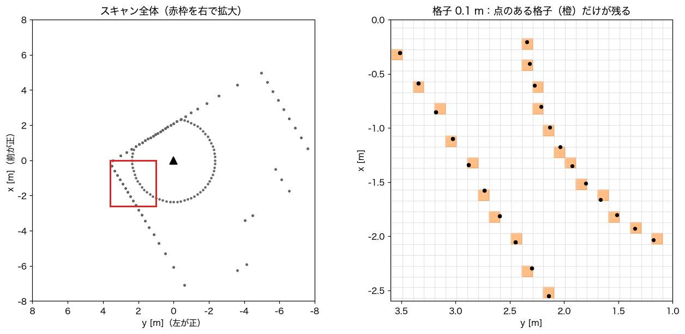
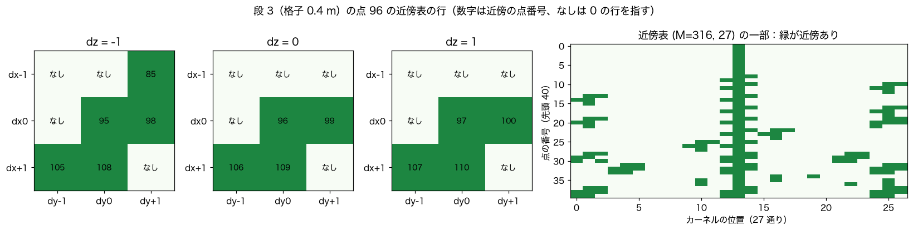
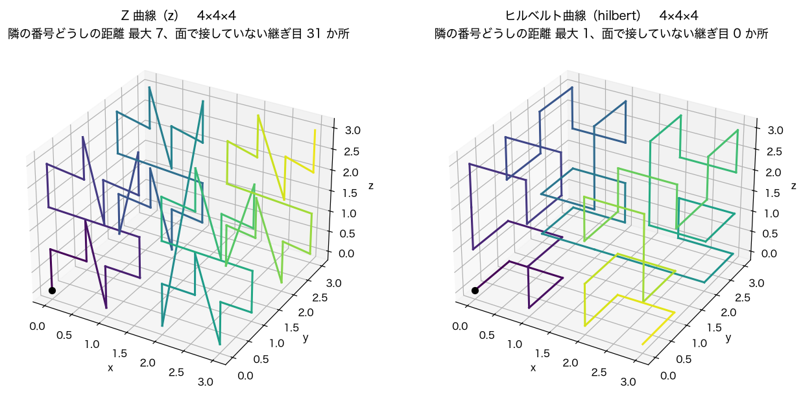
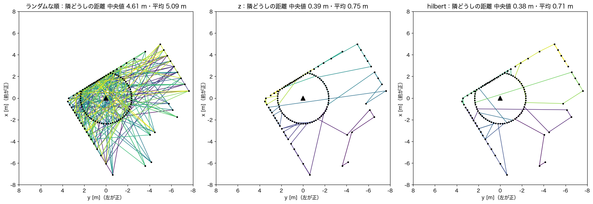
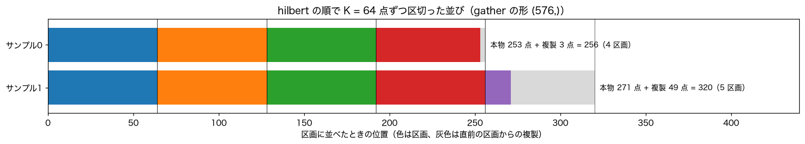
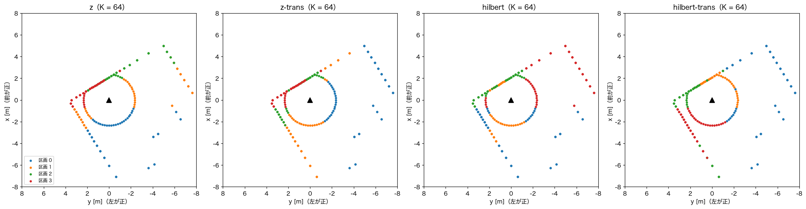

# Point Transformer V3 エンコーダの中身

`physical_pointnet/encoders/ptv3.py` が何をしているかを、順を追って説明します。補助の部品は `encoders/serialization.py`（点の並べ方）と `encoders/sparse_conv.py`（疎な 3D 畳み込み）にあります。

元の論文は Wu ほか「Point Transformer V3: Simpler, Faster, Stronger」（CVPR 2024、[arXiv:2312.10035](https://arxiv.org/abs/2312.10035)）です。構成と設定の名前は、公式実装 [Pointcept](https://github.com/Pointcept/Pointcept) の `PointTransformerV3` に合わせています。分割用のデコーダは持たず、最後に点群全体を 1 本のベクトルにまとめます。

図と出力例は、[pointnet2.md](pointnet2.md) と同じシミュレータのスキャンを、実際のエンコーダの関数に通して作ったものです（`scripts/make_doc_figures.py`）。重みは学習前の乱数です。

## 一言でいうと

点群を**一列に並べて、端から決まった数ずつ区切り、区切りの中で注意（attention）を掛ける**仕組みです。

PointNet++ は「中心を選んで、そのまわりの点を探す」ことを繰り返します。点が数万になると、この「探す」が一番重くなります。PTv3 は探しません。

```text
PointNet++                               PTv3
─────────                                ────
中心を選ぶ（最遠点サンプリング）         点を格子にそろえる（ボクセル化）
各中心から近い点を探す（近傍探索）       空間充填曲線の順に一列に並べる（整列）
近所ごとに全結合 → max                   端から K 点ずつ区切り、区切りの中で注意
                                         格子を粗くしてまとめる
```

並べ替えは整列（`argsort`）1 回、区切りは番号の付け替えだけなので、点が多くても軽く済みます。区切りの大きさは標準で 1024 点で、近傍探索の 16〜32 点よりずっと広い範囲を一度に見ます。

## なぜ PTv3 か

屋外の LiDAR は 1 フレームで数万〜十数万点あります。PointNet++ や Point Transformer V1/V2 は、点ごとに k 近傍か半径内の点を探すので、点が増えると近傍探索が一番重くなります。PTv3 はこれを並べ替えに置き換えたので、同じ GPU でより多くの点を、より広い範囲で扱えます。注意の計算は、GPU の flash attention にそのまま乗ります。

## 全体の流れ

シミュレータのスキャン 2 枚（253 点と 271 点）を、既定の設定（4 段）に通したときの実際の形です。

```text
PointBatch   coord (524, 3) メートル、feat (524, 3)、batch (524,)    ← 253 + 271 点
   │
   │ ① ボクセル化（格子 0.1 m）。同じ格子の点は平均で 1 つに      → 524 点（重なりなし）
   ▼
   │ ② 埋め込み：疎な 3D 畳み込み 5×5×5 → BatchNorm → GELU        → feat (524, 32)
   ▼
段 1  格子 0.1 m   ブロック × 1（xCPE → 区画の注意 → 全結合）       → (524, 32)    253 + 271 点
   │ ③ グリッドプーリング（格子を 2 倍に粗く）
段 2  格子 0.2 m   ブロック × 1                                     → (444, 64)    230 + 214 点
   │ ③
段 3  格子 0.4 m   ブロック × 1                                     → (316, 128)   169 + 147 点
   │ ③
段 4  格子 0.8 m   ブロック × 1                                     → (172, 256)    99 +  73 点
   │
   │ ④ サンプルごとに max
   ▼
出力  (2, 256)
```

段が進むと格子が粗くなって点が減り、1 点あたりの特徴の幅が増えます。PointNet++ で中心の数を減らしていくのと同じ役割です。各段の格子を上から見ると次のようになります（青い四角が点のある格子）。



forward の全体はこれだけです。

```242:256:physical_pointnet/encoders/ptv3.py
    def forward(self, points: PointBatch) -> torch.Tensor:
        coord, feat, batch = points.coord, points.feat, points.batch
        origin = segment_reduce(coord, batch, points.batch_size, "min")
        grid = torch.floor((coord - origin[batch]) / self.grid_size).long()
        grid, batch, coord, feat = _merge_voxels(grid, batch, coord, feat, "mean")

        stage = _Stage(grid, batch, points.batch_size, self._stage_orders())
        feat = self.embed_act(self.embed_norm(self.embed_conv(feat, stage.table(self.embed_kernel))))
        for s, blocks in enumerate(self.stages):
            if s > 0:
                grid, batch, coord, feat = self.pools[s - 1](grid, batch, coord, feat)
                stage = _Stage(grid, batch, points.batch_size, self._stage_orders())
            for i, block in enumerate(blocks):
                feat = block(feat, stage, i % len(self.orders))
        return global_pool(feat, batch, points.batch_size, self.pool)
```

PointNet++ と違い、PTv3 は点を表に詰め直しません。最初から最後まで、全サンプルを縦につないだ `(点数, チャネル)` のまま計算します。どの点がどのサンプルかは `batch` で持ち続けます。

以下、①〜④を順に見ていきます。

## ① ボクセル化：点を格子にそろえる

まず各点の座標を、格子 `grid_size`（既定 0.1 m）の番号に変えます。原点はサンプルごとの最小の座標なので、番号は 0 以上の整数になります。

```python
origin = segment_reduce(coord, batch, points.batch_size, "min")   # サンプルごとの最小の xyz
grid = torch.floor((coord - origin[batch]) / self.grid_size).long()
```

実際のスキャンでは次のようになります。

```text
origin（サンプルごとの最小の xyz）  [[-7.074, -7.610, 0.000],    ← サンプル0
                                     [-2.387, -7.002, 0.000]]    ← サンプル1
coord[0] = [-2.352, -0.000, 0.000]  →  grid[0] = [47, 76, 0]     （(-2.352 + 7.074) / 0.1 = 47.2 → 47）
grid の最大値                        [120, 111, 18]
```

同じサンプルの同じ格子に複数の点が入ったら、1 点にまとめます。座標は平均、特徴も平均です。

```143:156:physical_pointnet/encoders/ptv3.py
def _merge_voxels(
    grid: torch.Tensor, batch: torch.Tensor, coord: torch.Tensor, feat: torch.Tensor, reduce: str
) -> tuple[torch.Tensor, torch.Tensor, torch.Tensor, torch.Tensor]:
    """同じサンプルの同じボクセルに入る点を 1 つにまとめる。結果はサンプル番号の昇順に並ぶ。"""
    size = int(grid.max()) + 1
    key = ((batch * size + grid[:, 0]) * size + grid[:, 1]) * size + grid[:, 2]
    uniq, inverse = torch.unique(key, return_inverse=True)
    n = uniq.numel()
    new_batch = uniq // (size**3)
    rest = uniq % (size**3)
    new_grid = torch.stack([rest // (size * size), (rest // size) % size, rest % size], dim=1)
    new_coord = segment_reduce(coord, inverse, n, "mean")
    new_feat = segment_reduce(feat, inverse, n, reduce)
    return new_grid, new_batch, new_coord, new_feat
```

サンプル番号と格子番号を 1 つの整数（`key`）にまとめ、`torch.unique` で同じ値をまとめています。小さな例で動かすと次のようになります。

```text
入力 4 点（格子 0.1 m）
  coord [0.02, 0.03, 0]  feat [1, 0]   → grid [0, 0, 0]  ┐ 同じ格子
  coord [0.07, 0.01, 0]  feat [3, 0]   → grid [0, 0, 0]  ┘
  coord [0.15, 0.02, 0]  feat [5, 1]   → grid [1, 0, 0]
  coord [0.31, 0.00, 0]  feat [7, 1]   → grid [3, 0, 0]

_merge_voxels の出力 3 点
  grid [0, 0, 0]  coord [0.045, 0.02, 0]  feat [2, 0]   ← 2 点の平均
  grid [1, 0, 0]  coord [0.150, 0.02, 0]  feat [5, 1]
  grid [3, 0, 0]  coord [0.310, 0.00, 0]  feat [7, 1]
```

実際のスキャンを拡大すると次のとおりです。橙の四角が点のある格子で、点のない格子は最初から存在しません。



シミュレータのスキャンは点が 0.2 m 前後おきなので、格子 0.1 m では 1 つの格子に 1 点ずつしか入らず、まとめられる点はありません（524 点 → 524 点）。屋外の密な LiDAR では、近くの点が同じ格子に何点も入るので、ここで点数が減ります。

## ② 埋め込み：疎な 3D 畳み込み

最初の特徴（3 チャネル）を、5×5×5 の疎な 3D 畳み込みで 32 チャネルにします。このあと各ブロックの xCPE でも、3×3×3 の同じ種類の畳み込みを使います。

### 疎な畳み込みとは

画像の 3×3 畳み込みは、「自分と上下左右斜めの 9 画素」に重みを掛けて足します。3D なら 3×3×3 = 27 個の格子です。点群をすべての格子で埋めた 3D 画像にすると、ほとんどが空の格子になり無駄です。

疎な畳み込み（submanifold sparse convolution）は、**点のある格子にだけ出力を作り、近傍も点のある格子だけを使います**。点のない近傍は 0 として扱います。公式実装は spconv（CUDA 専用）を使いますが、ここでは同じ計算を PyTorch だけで書いています。

### 近傍表を作る

まず、「各点について、27 か所の近傍の格子に点があれば、その点の番号」を表にします。

```15:34:physical_pointnet/encoders/sparse_conv.py
def neighbor_table(grid: torch.Tensor, batch: torch.Tensor, kernel_size: int) -> torch.Tensor:
    """各ボクセルについて、kernel_size^3 個の近傍ボクセルの番号を返す。無ければ M。

    grid はサンプルの中で重複しない非負整数座標 (M, 3)。
    """
    r = kernel_size // 2
    steps = torch.arange(-r, r + 1, device=grid.device)
    offsets = torch.stack(torch.meshgrid(steps, steps, steps, indexing="ij"), dim=-1).reshape(-1, 3)
    shifted = grid + r
    size = int(shifted.max()) + r + 1

    def key(g: torch.Tensor, b: torch.Tensor) -> torch.Tensor:
        return ((b * size + g[..., 0]) * size + g[..., 1]) * size + g[..., 2]

    count = grid.shape[0]
    sorted_keys, perm = key(shifted, batch).sort()
    query = key(shifted.unsqueeze(1) + offsets.unsqueeze(0), batch.unsqueeze(1))
    pos = torch.searchsorted(sorted_keys, query.reshape(-1)).clamp(max=count - 1).view_as(query)
    found = sorted_keys[pos] == query
    return torch.where(found, perm[pos], torch.full_like(pos, count))
```

1. 各点の（サンプル番号、格子番号）を 1 つの整数の鍵にして、整列しておく。
2. 各点について、27 通りにずらした格子の鍵を作る。
3. 整列した鍵の中を二分探索（`searchsorted`）して、同じ鍵があればその点の番号、なければ `M`（点の総数）を入れる。

小さな例です。サンプル0 に 3 点、サンプル1 に 1 点あり、サンプル1 の点はサンプル0 の 0 番と同じ格子にあります。

```text
点 0  grid [1, 1, 0]  サンプル0
点 1  grid [2, 1, 0]  サンプル0     ← 点 0 から見て dx = +1
点 2  grid [1, 2, 0]  サンプル0     ← 点 0 から見て dy = +1
点 3  grid [1, 1, 0]  サンプル1     ← 点 0 と同じ格子だが別のサンプル

neighbor_table(..., kernel_size=3) の形 (4, 27)
行 0  [4, 4, 4, 4, 4, 4, 4, 4, 4, 4, 4, 4, 4, 0, 4, 4, 2, 4, 4, 4, 4, 4, 1, 4, 4, 4, 4]
行 3  [4, 4, 4, 4, 4, 4, 4, 4, 4, 4, 4, 4, 4, 3, 4, 4, 4, 4, 4, 4, 4, 4, 4, 4, 4, 4, 4]
```

27 個の並びは (dx, dy, dz) が (-1,-1,-1)、(-1,-1,0)、…、(+1,+1,+1) の順で、13 番目（0 から数えて）が自分自身です。行 0 では、13 番目に自分（0）、16 番目（dy = +1）に点 2、22 番目（dx = +1）に点 1 が入り、残りは「なし」を表す 4 です。点 3 は同じ格子でもサンプルが違うので、点 0 の近傍に入りません。

実際のスキャンの段 3（格子 0.4 m）で、近傍の多い点の行を 3×3×3 に並べ直すと次のようになります。



右は表の先頭 40 行です。真ん中の列（自分自身）は必ず緑で、壁に沿った点は壁の方向の近傍だけが緑になります。

### 畳み込みの計算

表ができれば、畳み込みは「表で特徴を集めて、行列を 1 回掛ける」だけです。

```49:54:physical_pointnet/encoders/sparse_conv.py
    def forward(self, feat: torch.Tensor, table: torch.Tensor) -> torch.Tensor:
        padded = torch.cat([feat, feat.new_zeros(1, feat.shape[1])], dim=0)
        out = padded[table].reshape(feat.shape[0], -1) @ self.weight.to(feat.dtype)
        if self.bias is not None:
            out = out + self.bias.to(feat.dtype)
        return out
```

```text
feat                (M, C)            ← 末尾に 0 の行を 1 つ足して (M + 1, C)
padded[table]       (M, 27, C)        ← 「なし」(= M) は 0 の行を指す
reshape             (M, 27 × C)
@ weight            (27 × C, C_out)
out                 (M, C_out)
```

同じ重みで密な `torch.nn.functional.conv3d` を計算し、点のある格子の値を比べると、差は 1e-7 程度で一致しました。

### このシミュレータでの注意

各段で 3×3×3 の近傍に入る点の数（自分を含む平均）は次のとおりでした。

| 段 | 格子 | 点数（サンプル0） | 3×3×3 の近傍の平均 |
| --- | --- | --- | --- |
| 1 | 0.1 m | 253 | 1.7 |
| 2 | 0.2 m | 230 | 2.8 |
| 3 | 0.4 m | 169 | 4.8 |
| 4 | 0.8 m | 99 | 6.7 |

シミュレータのスキャンは点の間隔（約 0.2 m）が格子 0.1 m より広いので、段 1 では近傍がほとんど自分だけです。この段の畳み込みは、実質的に点ごとの全結合として働きます。屋外の密な LiDAR を格子 0.05 m にすると、壁や地面の上では隣の格子が埋まり、畳み込みが形を捉えます。シミュレータで使うなら、`grid_size` を点の間隔に近い 0.2 m にする選択もあります。

## ③ 直列化：空間充填曲線の順に並べる

ここが PTv3 の中心です。3 次元の格子を、空間で近い格子が番号でも近くなるように、1 本の線でたどります。その線を空間充填曲線と呼びます。

### Z 曲線とヒルベルト曲線

4×4×4 の格子を、それぞれの曲線の番号順につないだ図です。色が紫から黄に変わる向きに進みます。



- **Z 曲線**（モートン順）は、x、y、z の 2 進数のビットを交互に並べた数を番号にします。計算は簡単ですが、ところどころで遠くへ跳びます（4×4×4 で 31 か所）。
- **ヒルベルト曲線**は、番号が 1 つ違う格子が必ず面で接するように折り返します。跳びがありません。

Z 曲線の計算は、ビットを並べ替えるだけです。

```10:16:physical_pointnet/encoders/serialization.py
def z_order_encode(grid: torch.Tensor, depth: int) -> torch.Tensor:
    """(M, 3) の非負整数座標を Z 曲線（モートン順）の番号にする。"""
    code = torch.zeros(grid.shape[0], dtype=torch.long, device=grid.device)
    for bit in range(depth):
        for axis in range(3):
            code |= ((grid[:, axis] >> bit) & 1) << (3 * bit + 2 - axis)
    return code
```

```text
grid [0,0,0] → 0     grid [1,0,0] → 4     grid [0,1,0] → 2     grid [1,1,0] → 6
grid [0,0,1] → 1     grid [3,2,1] → 53

[3,2,1] は x = 11、y = 10、z = 01（2 進数）
  下の桁から (x, y, z) のビットを 1 組ずつ取る：(1, 0, 1) → 101、(1, 1, 0) → 110
  上の組から並べると 110 101 = 53
```

ヒルベルト曲線は Skilling の方法（`hilbert_encode`）で計算しています。8×8×8 の 512 個の格子で、番号が重複せず、番号が隣の格子どうしが必ず面で接することを確かめています。

### サンプル番号を上位の桁に入れる

バッチには複数のサンプルが混ざっています。番号の上位の桁にサンプル番号を入れておけば、全点を 1 回整列するだけで、サンプル0 の点が全部並んだあとにサンプル1 の点が並びます。

```51:61:physical_pointnet/encoders/serialization.py
def serialize(grid: torch.Tensor, batch: torch.Tensor, order: str, depth: int) -> torch.Tensor:
    """サンプル番号を上位ビットに置いた直列化の番号。並べ替えるとサンプルごとにまとまる。"""
    if order.endswith("-trans"):
        grid = grid[:, [1, 0, 2]]
    if order.startswith("z"):
        code = z_order_encode(grid, depth)
    elif order.startswith("hilbert"):
        code = hilbert_encode(grid, depth)
    else:
        raise ValueError(f"order は {', '.join(ORDERS)} のどれかです。")
    return (batch << (3 * depth)) | code
```

実際のスキャンでは格子番号の最大が 120 なので、1 軸 7 ビット（`depth` = 7）、3 軸で 21 ビットです。サンプル1 の番号は 2²¹ = 2,097,152 を足した値になり、サンプル0 のどの番号よりも大きくなります。

```text
order          サンプル0 の先頭 3 点の番号          サンプル1 の最小の番号
z              524426, 524930, 528515               2097310
z-trans        1048844, 1049348, 1052933            2097454
hilbert        1010793, 1008469, 1006962            2097238
hilbert-trans  1975419, 1975925, 1979506            2097320
```

`-trans` は x と y を入れ替えてから番号を付けます。曲線の向きが変わるので、別の並び方になります。

### 実際のスキャンを並べる

スキャンの点を、それぞれの順番で線につないだ図です。左はランダムな順、中央は Z 曲線、右はヒルベルト曲線です。



ランダムな順では、隣どうしの点が平均 5 m 離れています。曲線の順にすると、隣どうしの距離の中央値は約 0.4 m になり、ほとんどの点が空間で近い点の隣に来ます。ところどころ長い線があるのは、曲線が別の場所へ移る継ぎ目です。

## ④ 区画に区切る

並べた列を、端から `K` 点ずつ区切ります。1 つの区切りを区画（patch）と呼びます。区画の中の点は、曲線の上で近い点、つまりほぼ空間で近い点の集まりです。

### 区画の番号の作り方

```47:69:physical_pointnet/encoders/ptv3.py
    def patches(self, order_index: int, patch_size: int) -> tuple[torch.Tensor, torch.Tensor, int]:
        """区画に並べるための番号を返す。

        区画の大きさはバッチ内の最小点数を超えないようにする。各サンプルの点数を区画の
        倍数に足りるまで、直前の区画の点を複製して埋める（公式実装と同じ）。
        返り値は、区画に並べるときに取る元の点番号 (P*K,)、元の点ごとの区画上の位置 (M,)、K。
        """
        key = (order_index, patch_size)
        if key not in self._patches:
            counts = self.counts
            k = int(min(patch_size, int(counts.min())))
            padded = (counts + k - 1) // k * k
            start = torch.cumsum(counts, 0) - counts
            pad_start = torch.cumsum(padded, 0) - padded
            sample = torch.repeat_interleave(torch.arange(self.batch_size, device=counts.device), padded)
            local = torch.arange(int(padded.sum()), device=counts.device) - pad_start[sample]
            real = local < counts[sample]
            src = torch.where(real, local, local - k)
            gather = self.perms[order_index][start[sample] + src]
            back = torch.empty_like(gather[: self.grid.shape[0]])
            back[gather[real]] = torch.nonzero(real).squeeze(1)
            self._patches[key] = (gather, back, k)
        return self._patches[key]
```

返すのは 2 つの番号の列です。

- `gather`：区画の並びの各位置に、元のどの点を置くか。`feat[gather]` で区画の並びになる。
- `back`：元の各点が、区画の並びのどの位置にいるか。`out[back]` で元の点の順に戻る。

サンプルの点数が `K` で割り切れないと、最後の区画が足りません。足りない分は、**直前の区画の同じ位置の点を複製**して埋めます。複製した位置の出力は、`back` で戻すときに使われません。

小さな例です。一直線に並んだ点が、サンプル0 に 5 点、サンプル1 に 7 点あり、`patch_size` = 4 とします。

```text
K = min(4, 最小の点数 5) = 4
サンプル0：5 点 → 8 枠（2 区画）    サンプル1：7 点 → 8 枠（2 区画）

gather を区画ごとに並べたもの
  区画 0  [0, 1, 2, 3]
  区画 1  [4, 1, 2, 3]       ← 本物は 4 だけ。1, 2, 3 は直前の区画からの複製
  区画 2  [5, 6, 7, 8]
  区画 3  [9, 10, 11, 8]     ← 本物は 9, 10, 11。8 は直前の区画からの複製

back（元の点 0〜11 が区画の並びのどこにいるか）
  [0, 1, 2, 3, 4, 8, 9, 10, 11, 12, 13, 14]
   └─ 点 5 は区画の並びの位置 8（区画 2 の先頭）にいる
```

区画 1 の注意では、点 4 は点 1、2、3 の複製と一緒に計算されます。複製した 1、2、3 の出力は捨て、点 1、2、3 の結果は区画 0 のものを使います。

実際のスキャン 2 枚（253 点と 271 点、`K` = 64）では、次のような並びになります。



```text
gather の形 (576,)  = 256 + 320 枠 = 9 区画 × 64 点
back の形   (524,)  = 本物の点の数
```

サンプル0 は 253 点なので、4 区画（256 枠）のうち最後の 3 枠だけが複製です。サンプル1 は 271 点なので、5 区画目には本物が 15 点しかなく、残り 49 枠が複製です。

### 並べ方を替えると区画が変わる

同じスキャンを 4 通りの並べ方で区切り、区画ごとに色を付けた図です。



どの並べ方でも、1 つの区画はほぼひとまとまりの場所になっています。ただし区画の境目は並べ方ごとに違います。ある並べ方で区画の境目に分かれてしまった 2 点も、別の並べ方では同じ区画に入ることがあります。

PTv3 はブロックごとに並べ方を替えます（`i % len(self.orders)`）。1 段に 4 ブロックあれば 4 通りすべてを使い、境目をまたいだ情報も伝わります。学習中は段ごとに並べ方の順番をシャッフルします（`shuffle_orders`）。

### `K` がバッチの最小点数で決まること

`K` は `patch_size` とバッチ内の最小点数の小さいほうです。極端に点の少ないサンプルが混ざると、そのバッチ全体の区画が小さくなります。単独で推論したときとバッチの中で推論したときで、出力が少し変わるのはこのためです。ここは公式実装と同じ作り方です。

実データでは、前処理後の点数が最後の段でも `patch_size` を下回らない程度に、`grid_size` と `stride` を決めるのが目安です。上の例では最後の段が 99 点と 73 点で、`patch_size` = 64 を上回っています。

## 区画の中の注意

区画ができたら、区画ごとに多頭の自己注意を掛けます。

```96:103:physical_pointnet/encoders/ptv3.py
    def forward(self, feat: torch.Tensor, stage: _Stage, order_index: int) -> torch.Tensor:
        gather, back, k = stage.patches(order_index, self.patch_size)
        channels = feat.shape[1]
        qkv = self.qkv(feat[gather]).reshape(-1, k, 3, self.num_heads, channels // self.num_heads)
        q, key, v = qkv.permute(2, 0, 3, 1, 4).unbind(0)
        out = F.scaled_dot_product_attention(q, key, v, dropout_p=self.attn_drop if self.training else 0.0)
        out = out.transpose(1, 2).reshape(-1, channels)[back]
        return self.proj_drop(self.proj(out))
```

段 1（32 チャネル、頭 2 つ）の実際の形です。

```text
feat                       (524, 32)            ← 元の点の順
feat[gather]               (576, 32)            ← 区画の並び（複製を含む）
qkv(...)                   (576, 96)            ← q、k、v をまとめて計算
reshape                    (9, 64, 3, 2, 16)    ← 区画 × 区画内の点 × (q,k,v) × 頭 × 頭の幅
q, key, v                  (9, 2, 64, 16) ずつ  ← 区画 × 頭 × 区画内の点 × 頭の幅
scaled_dot_product_attention  (9, 2, 64, 16)    ← 区画の中の 64 点どうしで注意
transpose + reshape        (576, 32)
[back]                     (524, 32)            ← 元の点の順に戻す。複製の出力は捨てる
```

注意では、各点が区画の中のすべての点との「関係の強さ」を計算し、その重みで他の点の特徴を集めます。PointNet++ の max は「近所に何があるか」だけを見ますが、注意は「どの点を重く見るか」も学習で決めます。

`scaled_dot_product_attention` は PyTorch の関数で、CUDA では flash attention などの速い実装が自動で選ばれます。

## ブロック

区画の注意は、ブロックの中の 1 つの部品です。ブロック全体は次の 3 つを順に足し込みます。

```137:140:physical_pointnet/encoders/ptv3.py
    def forward(self, feat: torch.Tensor, stage: _Stage, order_index: int) -> torch.Tensor:
        feat = feat + self.cpe_norm(self.cpe_linear(self.cpe_conv(feat, stage.table(self.cpe_kernel))))
        feat = feat + self.drop_path(self.attn(self.norm1(feat), stage, order_index))
        return feat + self.drop_path(self.mlp(self.norm2(feat)))
```

```text
feat ──┬──────────────────────────────────────────────┐
       └─► 疎な畳み込み 3×3×3 → 全結合 → LayerNorm ──► 足す     … xCPE（位置の埋め込み）
feat ──┬──────────────────────────────────────────────┐
       └─► LayerNorm → 区画の注意 → drop path ───────► 足す     … 注意
feat ──┬──────────────────────────────────────────────┐
       └─► LayerNorm → 全結合 ×4 → GELU → 全結合 → drop path ► 足す   … 全結合
```

1. **xCPE**（位置の埋め込み）。注意は区画の中の点を「集合」として扱い、どの点がどこにあるかを直接は見ません。注意の前に疎な畳み込みを通すと、近傍の格子の配置が特徴に入るので、位置の情報を注意に渡せます。
2. **区画の注意**。上で説明したものです。
3. **全結合**。幅を `mlp_ratio`（既定 4）倍に広げて GELU を掛け、元の幅に戻します。点ごとに独立に掛かります。

どれも「元の特徴に足す」形（残差接続）で、正規化は各部品の前に置きます（pre-norm）。drop path は、学習中にサンプルごとに枝を確率的に丸ごと落とす正則化です。割合は浅いブロックで 0、最も深いブロックで `drop_path` になるように直線で増やします。

## グリッドプーリング：格子を粗くする

段の間で、格子番号を `stride`（既定 2）で割り、同じ番号になった点を 1 つにまとめます。2×2×2 = 8 個の格子が 1 つになります。

```159:171:physical_pointnet/encoders/ptv3.py
class _GridPooling(nn.Module):
    """ボクセルを stride 倍に粗くし、全結合のあと max でまとめる。"""

    def __init__(self, in_channels: int, out_channels: int, stride: int):
        super().__init__()
        self.stride = stride
        self.proj = nn.Linear(in_channels, out_channels)
        self.norm = nn.BatchNorm1d(out_channels)
        self.act = nn.GELU()

    def forward(self, grid, batch, coord, feat):
        grid, batch, coord, feat = _merge_voxels(grid // self.stride, batch, coord, self.proj(feat), "max")
        return grid, batch, coord, self.act(self.norm(feat))
```

```text
段 1 → 段 2   grid [47, 76, 0] // 2 = [23, 38, 0]   ← スキャンの先頭の点
              grid [46, 77, 0] // 2 = [23, 38, 0]   ← （説明用の例）同じ格子になるので 1 点にまとめる
特徴          全結合で 32 → 64 チャネルにしてから、まとめる点どうしで max
座標          まとめる点の平均
```

① のボクセル化と同じ `_merge_voxels` を使います。違うのは、特徴を平均ではなく max でまとめることと、その前に全結合で幅を広げることです。PointNet++ の「近所の max」と同じ考え方で、格子という決まった窓でまとめます。

上の「段ごとの格子」の図で、四角が 0.1 → 0.2 → 0.4 → 0.8 m と大きくなり、点が 253 → 230 → 169 → 99 と減っていくのがこの処理です。

## 全体のプーリング：1 本のベクトルにする

最後の段の点を、サンプルごとにまとめます。

```144:151:physical_pointnet/points.py
def global_pool(feat: torch.Tensor, batch: torch.Tensor, batch_size: int, mode: str) -> torch.Tensor:
    """点ごとの特徴をサンプルごとに 1 本のベクトルにする。mode は max、mean、max+mean。"""
    if mode == "max+mean":
        return torch.cat(
            [segment_reduce(feat, batch, batch_size, "max"), segment_reduce(feat, batch, batch_size, "mean")],
            dim=1,
        )
    return segment_reduce(feat, batch, batch_size, mode)
```

```text
最後の段  feat (172, 256)   batch [0 × 99 点, 1 × 73 点]
max       → (2, 256)
出力の先頭 6 個（サンプル0、学習前の重み）  [3.772, 1.619, 3.004, 3.778, 3.213, 1.529]
```

`max+mean` にすると、max と平均を横に並べて 2 倍の幅になります。この出力が状態の枝の出力と連結され、回帰ヘッドに入ります（[architecture.md](architecture.md)）。

## 設定

| 項目 | 既定値（シミュレータ向け） | 屋外の例（`configs/encoders/ptv3_outdoor.json`） | 中身 |
| --- | --- | --- | --- |
| `grid_size` | 0.1 | 0.05 | 最初の格子の大きさ（メートル） |
| `stride` | (2, 2, 2) | (2, 2, 2, 2) | 段の間で格子を何倍に粗くするか。段の数より 1 少ない |
| `enc_depths` | (1, 1, 1, 1) | (2, 2, 2, 6, 2) | 各段のブロック数 |
| `enc_channels` | (32, 64, 128, 256) | (32, 64, 128, 256, 512) | 各段の幅 |
| `enc_num_head` | (2, 4, 8, 16) | (2, 4, 8, 16, 32) | 各段の注意の頭の数。幅を割り切れる数 |
| `enc_patch_size` | (64, 64, 64, 64) | 1024 × 5 | 各段の区画の点数 |
| `orders` | 4 通りすべて | 同じ | 使う並べ方 |
| `shuffle_orders` | True | True | 学習中に並べ方の順番を替えるか |
| `mlp_ratio` | 4.0 | 4.0 | ブロック内の全結合を何倍に広げるか |
| `drop_path` | 0.1 | 0.3 | 最も深いブロックの drop path の割合 |
| `embed_kernel` | 5 | 5 | 埋め込みの畳み込みの大きさ |
| `cpe_kernel` | 3 | 3 | xCPE の畳み込みの大きさ |
| `pool` | `max` | `max+mean` | 最後のまとめ方。`max`、`mean`、`max+mean` |

屋外の例は Pointcept の既定のエンコーダ（5 段、1024 点の区画）と同じ大きさです。出力は `max+mean` なので 512 × 2 = 1024 次元、学習するパラメータはおよそ 3,870 万個です。シミュレータ向けの既定値は 4 段で、出力は 256 次元、パラメータはおよそ 355 万個です。

### 決め方の目安

| 何を決めるか | 目安 |
| --- | --- |
| `grid_size` | 点の間隔と同じくらい。前処理の `voxel_size` と同じか少し大きく。小さすぎると疎な畳み込みの近傍が空になる |
| `stride` と段の数 | 最後の段の格子（`grid_size` × stride の積）が、見たい一番大きな物と同じくらい |
| `enc_patch_size` | 最後の段の点数より小さく。大きいほど 1 回の注意で遠くまで見るが、計算は区画の点数の 2 乗で増える |
| `enc_depths` | 並べ方の数（4）の倍数にすると、全部の並べ方を均等に使う。浅い段は少なく、深い段を多く |
| `enc_channels` と `enc_num_head` | 頭の幅（チャネル ÷ 頭の数）を 16〜32 に |

## 公式実装との違い

| | Pointcept | このリポジトリ |
| --- | --- | --- |
| 疎な畳み込み | spconv（CUDA） | PyTorch だけの `SubMConv3d`（CPU でも動く） |
| 注意 | flash-attn パッケージ、なければ素の実装 | `torch.nn.functional.scaled_dot_product_attention`（CUDA では flash attention が自動で選ばれる） |
| 同じ格子の点 | データ読み込みの `GridSample` で 1 点だけ残す | 前処理の `voxel_size` で 1 点残し、エンコーダの中でも同じ格子の点を平均でまとめる |
| デコーダ | あり（分割用） | なし。全体のプーリングで 1 本にする |
| 相対位置の注意項（RPE） | オプション（既定はオフ） | なし |
| 区画の大きさと埋め方 | バッチ内の最小点数で縮め、直前の区画で埋める | 同じ |
| グリッドプーリング | 直列化の番号を右にずらしてまとめる | 格子番号を `stride` で割ってまとめる（同じ結果） |

公式の重み（ScanNet や nuScenes の分割用）は読み込みません。入力チャネル、段の数、デコーダの有無が違うので、このタスクでは最初から学習します。

GPU で疎な畳み込みが遅いときは、`SubMConv3d` を spconv のものに差し替えられます。入力の作り方が違うので、`_Stage.table` の代わりに spconv の `SparseConvTensor` を段ごとに作る形になります。

## PointNet++ との比較

| | PointNet++ | PTv3 |
| --- | --- | --- |
| 近所の決め方 | 中心から半径内の点を探す | 曲線の順で K 点ずつ区切る |
| 近所の大きさ | 16〜32 点 | 64〜1024 点 |
| 近所のまとめ方 | 全結合 → max | 自己注意（どの点を重く見るかを学習） |
| 位置の入れ方 | 相対位置 ÷ 半径を入力に連結 | 疎な畳み込み（xCPE） |
| 点の減らし方 | 最遠点サンプリング | 格子を粗くしてまとめる |
| バッチの持ち方 | 表に詰め直してマスク | 縦につないだまま |
| 点の並び順を入れ替えたとき | 推論で少し変わる（最遠点サンプリングの始点） | 変わらない（格子の番号だけで決まる） |
| バッチの中と単独で | 一致する | 最小点数で K が変わると少し変わる |
| 屋外の例の設定、6 万点 × 2、CPU | 約 4 秒 | 約 40 秒 |
| パラメータ（屋外の例） | 約 144 万 | 約 3,870 万 |

## 速さの目安

CPU（macOS、4 スレッド）で、屋外の例の設定に 6 万点 × 2 フレームを 1 回通すのに約 40 秒かかりました。同じ入力で PointNet++ の屋外の例は約 4 秒です。PTv3 の屋外設定は GPU で使う前提です。シミュレータ向けの既定値なら、300 点弱のスキャンは CPU でもすぐに通ります。

## よくある疑問

**曲線で一列にすると、近い点が遠い番号になることはない？**
あります。上の「並べ方ごとの点のつながり」の長い線がそれです。Z 曲線は特に跳びが多く、ヒルベルト曲線でも区画の境目では近い点が別の区画に分かれます。並べ方を 4 通り用意してブロックごとに替えるのは、この取りこぼしを別の並べ方で拾うためです。

**区画の中の点は、本当に近い点なの？**
ほぼ近い点です。「並べ方ごとの区画」の図で、各色がひとまとまりの場所になっています。ただし区画は「近い K 点」ではなく「曲線上で連続する K 点」なので、離れた 2 か所が 1 つの区画に入ることもあります。位置の情報は xCPE で入っているので、注意はそれを見て重みを決められます。

**PointNet++ より良いの？**
論文では、屋外の分割のベンチマーク（nuScenes、Waymo など）で、PointNet++ 系を含む従来の手法より精度が高く、速く動くと報告されています。ただしこのリポジトリではどちらもまだ学習していないので、このタスクでの比較結果はありません。シミュレータの 300 点弱のスキャンでは、PTv3 の利点（点が多くても速い、広い範囲を一度に見る）はあまり効きません。

## 確認したこと

学習はしていません。合成データとシミュレータのスキャンで次を確かめています。

- ヒルベルト曲線の番号が 8×8×8 の格子で重複せず、番号が隣の格子どうしは必ず面で接する。
- 疎な畳み込みが、同じ重みの密な `conv3d` と一致する（カーネル 3 と 5）。
- 区画の番号で、点数の違う 3 サンプルの全点がちょうど 1 回ずつ元に戻り、どの区画も 1 サンプルの点だけでできている。
- 区画が 1 つだけのとき、区画の注意が `nn.MultiheadAttention` と一致する。
- 点数の違うサンプル（30、300、1200 点、1 点だけのサンプルも含む）で順伝播と逆伝播が通り、全パラメータに有限の勾配が付く。
- 推論で点の並び順を入れ替えても出力が変わらない。
